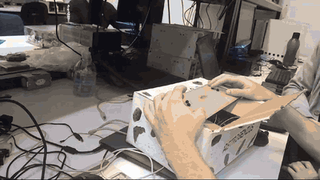

# A S T R O G E N I U S

**English** | [Português](README.pt-BR.md)

**AstroGenius** is an arcade-style asteroids game designed to be synthesized on an **FPGA board**. The player controls a ship in the middle of an asteroid field and must destroy the asteroids with shots (regular or special) while avoiding collisions.

Built for the course **PCS3635 – Digital Laboratory I** (Escola Politécnica, University of São Paulo, class T5BB5). The team's original repository is [henriqueedu2001/poli-asteroids](https://github.com/henriqueedu2001/poli-asteroids).

<p align="center">
  
  <br>
  <em>The game running on the FPGA, with the graphical interface on the monitor (clip from the week 4 delivery video).</em>
</p>

**Authors**
- [Felipe Luis Korbes](https://github.com/luis-fk)
- [Henrique S. Souza](https://github.com/henriqueedu2001)
- [João Felipe Souza Melo](https://github.com/jofe2003)

## Contents

- [Description](#description)
- [Demo](#demo)
- [Requirements](#requirements)
- [Installation](#installation)
- [Usage](#usage)
- [Project structure](#project-structure)
- [Project history](#project-history)
- [Byte tapes (debug mode)](#byte-tapes-debug-mode)
- [Serial transmission protocol](#serial-transmission-protocol)
- [License](#license)

## Description

The game was designed to work like an arcade cabinet: a controller fixed to the case and a monitor that shows the graphics. The project has three parts:

1. **Hardware (Verilog)**: all of the game logic (menu, asteroid and shot movement, collisions, score, lives and difficulty) runs on a **Cyclone V 5CEBA4F23C7N** FPGA. The top-level module is `astro_genius` (`src/AstroGenius/astro_genius.v`). It reads the player's commands from 6 switches/buttons and sends the game state through the `saida_serial` output.
2. **Serial communication (UART)**: the board sends the computer, over UART at 9600 baud, a 51-byte packet with the game state and, when the screen changes, a *menu byte*.
3. **Graphical interface (Python + pygame)**: reads the data from the serial port, decodes the packets and draws the screens (main menu, gameplay, game over, scores) on the monitor.

To test the interface without the board, there is a **debug mode**: the bytes come from a text file (a "byte tape") instead of the serial port.

## Demo

The GIF at the top is a 12-second clip from the video `jogoFuncionando.mp4`, recorded in the lab on 2024-04-03. It first shows the arcade controller (the box with the buttons, wired to the FPGA), then the screen with the score going up as the ship shoots the asteroids.

The full video (41 s) is inside `src/Entregas/semana4/PCS3635-T5BB5-Relatorio-Semana4.zip`.

## Requirements

### Graphical interface
- Python **3.8 or newer** (developed with 3.8 and 3.10)
- [pygame](https://www.pygame.org/) (developed with 2.5.2). On recent Python versions (tested with 3.14) `pygame` fails to install; use [pygame-ce](https://pypi.org/project/pygame-ce/) instead, which is compatible and works without code changes
- [pyserial](https://pypi.org/project/pyserial/) (only used in `gameplay` mode, but always imported)

### Hardware (optional, for synthesis or simulation)
- FPGA board with a Cyclone V **5CEBA4F23C7N** (e.g. DE0-CV)
- **Intel Quartus Prime**, to open the `.qar` files and program the board
- A USB-to-serial adapter connected to the board's `saida_serial` output
- [Icarus Verilog](https://steveicarus.github.io/iverilog/) and [GTKWave](https://gtkwave.sourceforge.net/), to run the testbenches
- [Digital](https://github.com/hneemann/Digital), to open the `.dig` circuits

## Installation

```bash
git clone https://github.com/jofe2003/astrogenius.git
cd astrogenius

# (recommended) virtual environment
python3 -m venv .venv
source .venv/bin/activate        # Windows: .venv\Scripts\activate

pip install pygame pyserial
# if pygame fails to install (Python 3.13+):
pip install pygame-ce pyserial
```

You can also download a specific version (see the [tags](https://github.com/jofe2003/astrogenius/tags)):

```bash
git clone --branch v2.0 --depth 1 https://github.com/jofe2003/astrogenius.git
```

## Usage

### 1. Graphical interface

The settings live in the `GAME_CONFIG` dictionary in `start_game.py`. After editing them, run from the repository root:

```bash
python start_game.py
```

Main `GAME_CONFIG` options:

| Key | Description |
|-----|-------------|
| `mode` | `'gameplay'` reads from the serial port (board); `'debug'` reads from a byte tape |
| `serial_port` | The board's serial port, e.g. `'COM4'` (Windows) or `'/dev/ttyUSB0'` (Linux) |
| `byte_tape` | Tape used in `debug` mode, without the extension: `'in_default'` or `'test_01'` |
| `screen_widht` / `screen_heigth` | Window size in pixels (the keys really are spelled this way) |
| `delay` | Pause in seconds between reads (useful to watch a tape in slow motion) |
| `print_*` | Enable debug prints in the terminal (buffer, chunk, UART, received data, current screen) |

**To test without the board**, set `'mode': 'debug'` and pick a tape in `byte_tape`. The tape is read in a loop, so the game keeps cycling through the screens until you close the window.

To list the available serial ports:

```bash
python -c "import serial.tools.list_ports as p; [print(x.device) for x in p.comports()]"
```

In `gameplay` mode, if the port cannot be opened, the program retries every 2 seconds.

### 2. Hardware

- **Quartus**: open `src/Quartus/astro_genius.qar` (*Project → Restore Archived Project*), compile it and program the board.
- **Simulation with Icarus Verilog**: `src/AstroGenius/` has a `comp.txt` file listing the files to compile:
  ```bash
  cd src/AstroGenius
  iverilog -c comp.txt -o sim && vvp sim
  gtkwave wave.vcd          # h.gtkw and menu.gtkw store signal layouts
  ```
  To run a different testbench, change which `*_tb.v` file is active in `comp.txt`.
- **Single file**: `src/AstroGenius/comp.py` merges every module into `digital.v`, which can be imported into the Digital simulator. This file is generated and not tracked in git:
  ```bash
  cd src/AstroGenius && python comp.py
  ```

## Project structure

Folder and file names are in Portuguese, as in the original project.

```
astrogenius/
├── start_game.py            # Entry point of the graphical interface (settings in GAME_CONFIG)
├── bytetapes/               # Byte tapes for debug mode and UART captures
├── docs/
│   ├── chunk_encoding.md    # Specification of the FPGA -> PC serial packet (in Portuguese)
│   └── media/demo.gif       # Clip from the demo video
└── src/
    ├── AstroGenius/         # Current hardware version (Verilog)
    │   ├── astro_genius.v   # Top-level module
    │   ├── jogo_base.v      # Game datapath
    │   ├── asteroide.v, tiro.v   # Asteroid and shot datapaths
    │   ├── UC/              # Control units (state machines) + testbenches in UC/tb/
    │   ├── Modulos/         # Building blocks: counters, registers, muxes, UART TX, memories...
    │   ├── tb/              # Submodule testbenches
    │   ├── comp.txt         # File list for iverilog
    │   ├── comp.py          # Generates digital.v (all modules in one file, not tracked)
    │   └── *.gtkw           # GTKWave signal layouts
    ├── Interface/           # Graphical interface in Python
    │   ├── main.py          # Game class: main loop, UART/tape input, screen switching
    │   ├── render/          # Screens (menu, gameplay, game over, scores, debug) and sprites in imgs/
    │   └── utilitary/       # UART, buffer, chunk and decoder, byte tape reader
    ├── Quartus/             # Archived Quartus project (astro_genius.qar)
    ├── Digital/             # Digital simulator circuits (.dig)
    ├── Verilog/             # First hardware version (legacy)
    ├── Entregas/            # Weekly course deliveries (see "Project history")
    ├── Pitch/               # Initial project pitch
    ├── Design/              # Design document
    └── Misc/                # Drafts and loose files
```

## Project history

The project was built over four lab weeks, from March to April 2024. Each week the team delivered a planning report (PDF) along with the Quartus project (`astro_genius.qar`) or the Verilog code at that point. These files are in `src/Entregas/` and show how the game grew. The reports are in Portuguese.

| Week | Date | Contents | Files |
|------|------|----------|-------|
| 1 | 2024-03-13 | Pitch, first version of the datapath and control units, Digital simulations and testbenches | `src/Pitch/PCS3635-T5BB5-Pitch-Semana1.pdf`, `src/Entregas/PCS3635-T5BB5-Planejamento-Semana_1.{pdf,zip}`, `src/Verilog/` |
| 2 | 2024-03-20 | Datapath and control units for asteroids and shots (moving, registering shots, checking collisions) | `src/Entregas/semana2/` (PDF, ZIP and the delivered Verilog in `Verilog/`) |
| 3 | 2024-03-27 | Requirements, first version of the serialization (UART) and the Quartus project | `src/Entregas/semana3/` |
| 4 | 2024-04-03 | Complete Verilog hardware, pygame graphical interface, serialization, cabinet model and arcade controller. The report includes the video of the working game | `src/Entregas/semana4/` |

The `.zip` files are the packages submitted each week (PDF + project) and are kept as a record. The final hardware version is in `src/AstroGenius/`. Released versions are marked with git tags: `v1.0`, `v1.0.1`, `v1.0.2`, `v1.0.3` and `v2.0`.

## Byte tapes (debug mode)

A byte tape is a `.bin` file in `bytetapes/`, written as **UTF-8 text**, that lists the bytes the interface will "receive". The ready-to-use tapes are `in_default.bin` (the default) and `test_01.bin`: both go through the main menu, gameplay and game over.

The files `fita_01.bin` to `fita_05.bin` are **not** tapes in this format. They are captures of real sessions with the board: terminal output saved as UTF-16, with the bytes received over UART in hexadecimal. They are kept as a record of the tests, but debug mode cannot load them.

```
# DEFAULT TEST TAPE
# comments start with # or //

input f0 # menu byte: main menu
input f4 # menu byte: gameplay

input # block 01 (51 bytes)
01 00 00 00 00 00 00 00
00 00 00 00 00 00 00 00
00 00 00 00 00 00 00 00
00 00 00 00 00 00 00 00
00 00 00 00 00 00 00 00
00 00 00 41 41 41 41 41
41 41 41
```

Rules:
- Each read starts with the `input` (or `INPUT`) token. `output`/`OUTPUT` are also accepted.
- Bytes are written in hexadecimal, with upper- or lowercase digits. Spaces and line breaks are ignored, but **each block must have an even number of hex digits**.
- Single-line comments use `#` or `//`. Everything after the token is ignored until the end of the line.
- A block with **a single byte** is treated as a *menu byte* and switches the screen. It must be one of the values below; any other single byte makes the program stop with a `KeyError`:

| Byte | Screen |
|------|--------|
| `F0` | Main menu |
| `F1` | Scores |
| `F2` | Game over |
| `F3` | Register score |
| `F4` | Gameplay |

## Serial transmission protocol

The board sends the game state in **51-byte** packets (*chunks*): 43 data bytes followed by 8 end-of-block bytes (the *break point*, `41 41 41 41 41 41 41 41`).

| Slice | Bytes | Contents |
|-------|-------|----------|
| PT | 1 | Score |
| G1 | 1 | Ship direction (2 bits), lives (3 bits), difficulty (3 bits) |
| AS | 16 | Asteroid positions (4 bits for x and 4 bits for y) |
| DA | 4 | Asteroid directions (2 bits each) |
| TI | 16 | Shot positions |
| DT | 4 | Shot directions |
| G2 | 1 | Flags: special shot played, special shot available, shot played, shot available, out of lives |
| BP | 8 | Break point |

Directions are encoded in 2 bits: `00` = RIGHT, `01` = LEFT, `10` = UP, `11` = DOWN.

The full specification (in Portuguese) is in [`docs/chunk_encoding.md`](docs/chunk_encoding.md).

## License

Released under the MIT License. See [`LICENSE`](LICENSE).
